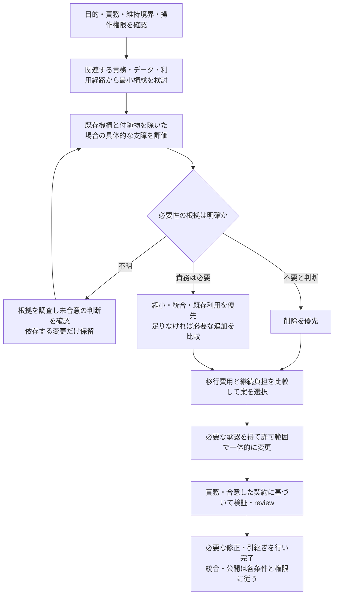

# 設計判断・文書化

共通AGENTS.mdの条件付き参照先。調査・設計・実装・reviewで共有判断の不足・矛盾を検出した時、共有方針の新設・変更や、それに伴う現行説明の更新・統合を判断する時に読む。文書作成の明示依頼を待たない。一方、単なる設計書の不在や全項目の充足を毎回監査する工程にはしない。

## 責務から最小構成を選ぶ

既存実装への追加・修正を出発点にせず、システムが果たすべき目的・責務と合意した契約から必要最小限の構成を考え、既存との差を評価する。新規追加の抑制だけでなく、蓄積した不要な仕組みを減らすことを通常の設計判断に含める。共通化するのはこの評価方法であり、製品の目的・保証範囲・責務・採用方式は対象repositoryの要求と合意から具体化する。

- 関連するコード、挙動、防御・事前チェック、revision等の管理状態、DBのテーブル・列・制約、設定、依存、互換層、fallback、test、文書を同じ基準で見直す。「既にある」「呼ばれている」「testがある」ことや、実装を写した文書は、その仕組みを必要とする独立した根拠にならない。
- 仕組みを、そのためだけの状態・チェック・利用側・test等と一緒に除いた時、どの責務・要求・合意した契約が、どの条件で具体的に成立しなくなるかを確認する。内部依存は影響調査の手掛かりであり、その依存全体を残す理由ではない。必要な責務があっても現在の方式が必要とは限らず、より小さい方式と比較する。
- 不要と判断できる仕組みは許可範囲で削除し、責務が必要なら縮小・統合・置換を優先する。必要性が不明なら「必要」「不要」のどちらにも確定せず、取得可能な根拠を調べ、残る判断と影響を示す。依存解消や移行のため一時的に残す場合は、恒久的な必要性と区別し、除去条件と必要な残件を既存の管理先で扱う。
- DBも保持する事実・正本・利用先から評価し、導出できる情報や同じ事実の複製を、必要な性能・監査・復旧等の根拠なく別管理しない。既存schemaとの互換性は無条件に保護しない一方、保持データの破棄・適用済みmigrationの書換え・環境の再作成は別の判断と操作権限を要する。詳細は[開発・review・統合](development.md)の維持境界に従う。

## 比較の順序と負担

削減 → 整理・既存利用 → 局所的な追加 → 横断的な追加 → 大規模改修の順に検討する。小さい案では満たせない具体的な要求・条件、または継続負担の不利が分かれば次へ進み、全段階の実装・試作は要求しない。関連機構の横断的な削減を「複数ファイルに及ぶから最後」と扱わず、小さい差分で動くことだけを理由に構造改善を避けない。

- 負担には状態・責務・依存・設定・失敗経路・運用手順・test・文書と、処理の流れ・正本・変更箇所・影響範囲を追う難しさを含める。防御・抽象化・永続化も、それ自身が生む不整合・故障点や、ユーザーの回避・復旧操作を妨げる制約を評価する。問題を避ける仕組みを重ねる前に、原因となる状態・分岐・重複を減らせないか検討する。
- 同じ責務・必要な品質・読みやすさを満たすなら、自前で保持する実装と管理対象が少ない案を優先する。行数・ファイル数・テーブル数の純減やコードの圧縮は目的にしない。必要な正規化・責務分割・入力検証・データ保護まで落とさず、追加依存へ複雑さを移すだけの案も負担を含めて比較する。
- 時間軸は、合意済みの計画・維持期間を踏まえ、変更・移行・検証の一時的な費用と継続保守・将来の変更容易性を比べるために使う。未確定の「いつか必要」や一般論だけを追加・温存の理由にせず、計画の存在だけで先行実装の許可ともしない。合理的に予見できる障害・安全上の具体的なリスクは評価し、事故の発生を対策の条件にしない。
- 実装者とレビュアーへ同じ基準を適用する。過剰という指摘は、関係する要求・前提、負担、削減案または単純な代案と、それでも果たせる責務を示す。影響に見合う比較で判断し、全候補の探索、最適性の証明、変更ごとの専用報告書・審査表は要求しない。必要な解と確認が揃ったら終え、改善探索を無期限に続けない。

これは判断の流れであり、毎回の全体監査や追加の承認工程ではない。既存合意で決まる内容は再確認せず、確認待ちでも独立した作業は進める。

## 調査範囲と残す判断

別の機能・セッション・将来の変更が依存する判断を優先し、後続が理解・実装する対象の現在の契約・仕組みを記述する。例えば、利用者向け契約、状態の所有者・正本、共有責務・依存方向、取消・排他・retry・復旧の担当、品質・運用条件、互換性の維持対象、採用方式と連携方法である。共有済みの情報と合わせてその判断が成立する内容を残す。既存合意を変えない変数の持ち方や補助関数への分割など、依頼内の局所選択に個別承認やADRを要求しない。

調査・比較は編集予定のファイルに閉じず、同じ責務・状態・データを共有する利用経路、DB、周辺の付随処理まで広げ、機構全体を減らす案を含める。ファイル数だけで依頼範囲内外を決めない。ただし、関連性のないrepository全体の監査や独立した別課題の改修を毎回始めず、調査・提案できる範囲と実変更の権限を分ける。判断に必要な情報が揃ったら止め、関係しない領域を先回りして定義しない。依頼・既存の合意で足りるなら新しい設計書を着手条件にしない。管理先・互換性境界等の不足による停止範囲は[開発・review・統合](development.md)に従う。

後続の実装・reviewで再利用する判断は、理由と適用範囲を既存の適切な場所へ残す。新規ファイルより追記・更新・参照で足りるかを先に確認する。READMEの数行で足りること、既存情報で足りて文書差分なしになることも認める。一時調査、タスクだけの比較、作業経緯・進捗は恒久ルールにしない。文書量は共有する判断で決め、規模別の文書一式・テンプレートを強制せず、設計情報のすべてを全タスクの常時指示にしない。

## 自律的な草案作成と採否確認

Codexが文書化の必要性・範囲・置き場を判断し、取得可能な情報を調べ、具体的な草案・更新差分と推奨案まで作る。依頼に必要な調査・草案作成について「文書を作ってよいか」を事前確認したり、不足だけを列挙して「定義してください」と返したりしない。推奨を選べない場合も、採否を左右する不足情報と候補への影響を示す。

| 対象 | 扱い |
| --- | --- |
| 確認済みの事実・既存合意 | 根拠を確認して説明・更新差分を作る。新しい方針がなければ再承認は不要。repository編集は依頼の操作範囲を守る |
| 未合意の共有方針 | 推奨案、理由、適用範囲、主な代案・追加負担・影響を草案とともに示し、判断の委譲がなければ採否を確認する |
| 合意を変えない局所選択・明示的に委譲された判断 | 許可された範囲で決めて進める。すべてを確認対象へ戻さない |
| 採用後の文書反映 | 回答を反映し、適切な文書と参照を更新する。承認範囲が変わらなければ再確認しない。書込み権限は別に満たす |

草案では確認済みの現状、既存の採用済み方針、推奨・仮定、未確認事項を読み分けられるようにする。例えば「現行実装は再起動後に処理を再開しない」という事実は、「今回の保証範囲に自動再開を含めない」という方針の採用ではない。固定schemaや専用の状態管理は設けない。

確認単位は文書全体ではなく設計判断とする。関連する判断はまとめ、個別に採用・修正・保留を回答できる形で、採用内容と上記の理由・影響、草案本文・根拠への到達手段を示す。一問ずつの不要な往復を増やさず、要約の裏で別の制約を追加しない。採用範囲だけを反映し、無回答を承認にしない。既存合意や明示的委譲を文言・書式の違いだけで再確認せず、推奨に合わせて要求・契約を弱めない。

## 操作権限と停止中の扱い

- read-onlyの調査・review等では回答内または許可された作業領域に草案・更新差分を作り、repositoryの有効文書やコードを編集しない。SessionFolderが提供され、用途・権限が合う場合は既存ルールどおり使い、保存先を不必要に確認し直したり未提供pathを創作したりしない。
- Issue／PRへの掲載は外部writeの許可範囲で行う。文書化や方針の採用は、依頼範囲の実質的拡張、破壊的操作、push、merge、公開等の許可を代替しない。独自の整合性管理等の既存の明示承認条件も維持する。
- 未承認の提案を有効なAGENTS.md、契約、実装・reviewの必須基準へ昇格させない。草案という表記や置き場だけで実質的に採用扱いさせない。
- 確認待ちの判断に依存する変更と、既存合意だけで可能な独立した作業を、実際の差分と依存先に基づいて分ける。安全性を未調査のまま独立した作業とみなさず、必要な禁止範囲を維持する。
- 互換性境界の不足・矛盾が変更可否を左右する場合は、タグ・契約・実際の適用状況から候補と推奨案・草案を作って確認する。バグ管理先等も既存の運用・記録を調べ、具体的な確認案を示す。草案作成を定義確定とみなして、その判断に依存する変更へ進まない。

## 採用と適用、判断の再利用

設計判断が採用されたことと、そのbranchで実装済みであることを分ける。必要な範囲で、提案、採用済み・未適用、適用済み、置換・撤回等が区別できればよく、全ファイルに固定status欄を追加する必要はない。

- 採用済み・未適用の判断は合意範囲の実装根拠になり得るが、現行機能の説明にはしない。未実装案を一般の現行設計書に既成の機能として書かない。
- 却下・保留の案を有効な規約に残さない。判断履歴を残す場合はADRに記録する。
- 後続の実装・reviewでは前提・対象が現在も成立するかを確認し、同じなら判断を再利用する。新たな根拠なくゼロから再審査しない。要求・運用条件が変わったら関係する判断だけを再評価し、過去の合意を永久の正解にしない。

例えば、個別取消と保存データ保護を既存の実行管理で担う設計では、取消経路、保護するデータ、管理元を選んだ理由を共有する。同じ前提のMonitorは同じ管理元を使う。後に異常終了からの復旧が合意されたら、その条件に照らして永続化の必要性を再評価する。後の要求追加だけを理由に当初の判断を誤りとせず、共有する判断の適用条件と根拠を更新する。

## branch間の文書更新と保存

- 現行説明は、その文書を含むbranchの実装・設定・実際の経路に対応させる。全branchを最も進んだbranchの説明へ先行更新しない。採用済み・未適用の判断を残す場合も、現行説明とは区別する。
- 個別機能の担当が、直接変更する仕様・path・契約の説明を実装と同じ論理変更で更新する。全機能統合後の一括整備へ丸投げしない。作業中の全commitで完成文書を要求せず、review・統合へ出す論理変更として揃える。
- 後続branchは必要な実装・現行説明・採用判断を同じ履歴として取り込み、文書だけ最新版に置き換えない。統括担当は統合結果の共有契約・正本・責務・実際の呼び出し経路を確認し、Gitの文字列競合が消えただけで完了としない。
- 設計・契約・既存説明が変わらない修正では文書差分なしでよい。全機能にADRを要求しない。無関係な全面整理や表現改善を統合ブロッカーへ広げず、[開発・review・統合](development.md)の必須条件と修正分離を維持する。
- 置換・廃止の担当は現行説明と参照を同じ論理変更で更新・削除する。ADRとリリースノート以外の文書・ソースコード・コメント・設定・testには現行の情報だけを残す。古い定義、廃止済みの実装・説明、後方互換性のためだけの旧定義の併記、移行経緯、完了済み計画は削除する。「参考」「適用対象外」等の注記やarchiveへの移動で温存しない。現在有効な互換維持契約と、それを満たす必要な実装・testは現行仕様として扱い、この規則を契約やデータ保護の無断廃止に使わない。
- ADRは削除せず、当時の判断と本文を保持する。置換・撤回時は現行運用の適用対象外であることと、後継判断または現行定義への参照を明記する。全変更にADRの新設を要求しない。
- 各repositoryのリリースノートは`docs/releases/`に残し、公開ごとの変更、互換性、検証結果を記録する。リリースノートから詳細ドキュメント・ソースコードへリンクする場合は、当該リリースの内容に対応するGit commitの完全ハッシュで固定する。GitHubでは`https://github.com/<owner>/<repo>/blob/<full-commit-hash>/<path>`の形式を使い、固定先の内容を確認する。
- 計画・調査ログをADRやリリースノートへ改名・丸ごと転載して保存規則を迂回しない。必要な判断・公開記録だけを記載し、詳細はGit履歴を参照する。未commitの一時資料が必要なら許可された作業領域を使い、履歴参照のためだけに恒久文書化しない。

規約を書いたことを実効性や承認漏れの機械的な完全防止の証明としない。承認workflow・審査台帳・文書同期エンジン等の新しい管理基盤は作らない。
